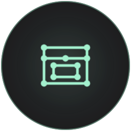

<div align="center">



# Lumenshot 截图工作台

**🚀 Linux 下开箱即用的离线截图工具**

区域截图 · 窗口捕获 · 就地标注 · 离线 OCR · 置顶贴图

[](https://github.com/githublbw/Lumenshot/releases/latest)
[](https://github.com/githublbw/Lumenshot/releases/latest)
[](#-隐私与离线能力)

</div>

---

## ✨ 功能特性

| 功能 | 说明 |
| --- | --- |
| 🖼️ **多种截图方式** | 区域截图、窗口捕获、整屏截图，全局热键一键唤起 |
| ✏️ **就地标注** | 画笔、几何形状、文字、马赛克笔刷、对话气泡，支持撤销与重做 |
| 🔍 **离线 OCR** | RapidOCR（PP-OCRv4，中英双语），识别结果可修正后一键复制 |
| 📌 **置顶贴图** | 把截图钉在桌面最前端，对照参考随时可用 |
| 🧊 **自包含安装** | 自带私有 Qt 运行库与 OCR 模型，不污染系统依赖，一条命令完成安装 |

> 💡 **开箱即用**：安装后自动注册命令行 `lumenshot`、应用菜单「Lumenshot 截图工作台」和桌面图标，关闭工作台后会驻留托盘，随时从托盘或菜单重新唤起。

---

## ⌨️ 快捷键

| 快捷键 | 功能 |
| --- | --- |
| `Ctrl+Alt+A` | 唤起区域截图（默认，可在设置中更换为 `F1` / `F2` / `F3` 等） |
| `O` | 对当前截图执行 OCR 文字提取 |
| 鼠标 | 所有截图与编辑功能均可纯鼠标操作 |

🛠️ 进入「菜单 → 设置」还可以开启开机自启、更改保存目录，或换掉与其他应用冲突的全局热键。

---

## 📦 安装

前往 [Releases](https://github.com/githublbw/Lumenshot/releases/latest) 下载最新的 `deb` 安装包，然后一条命令安装：

```bash
sudo apt install ./lumenshot_0.1.0_amd64.deb
```

✅ 安装 / 升级 / 卸载都由 `apt` 自动管理，程序位于 `/opt/lumenshot`，卸载命令：

```bash
sudo apt remove lumenshot
```

> 📝 卸载不会删除你保存过的截图与偏好设置。

---

## 🔨 从源码构建

🎯 **目标环境**：Ubuntu 22.04（其他发行版未验证）

### 1️⃣ 安装编译依赖

```bash
sudo apt install g++ cmake make qt6-base-dev qt6-qpa-plugins libxcb1-dev
```

### 2️⃣ 构建与测试

```bash
cmake -S . -B build -DCMAKE_BUILD_TYPE=Release -DBUILD_TESTING=ON
cmake --build build --parallel
ctest --test-dir build --output-on-failure
```

### 3️⃣ 安装到当前用户（免 sudo）

```bash
bash packaging/user-install.sh install build/lumenshot
```

### 4️⃣ 打包 deb（可选）

```bash
VERSION=0.1.0 bash packaging/build-deb.sh build/lumenshot
```

> ⚠️ OCR 推理库已随仓库 `third_party/onnxruntime` 内置，模型位于 `assets/ocr`；若两者缺失，应用仍可正常构建，只是不显示识别按钮。

---

## 📁 项目结构

```text
src/            应用源码（C++ / Qt6）
assets/         图标、UI 素材与 OCR 模型
packaging/      deb 打包脚本与安装/卸载工具
tests/          单元测试
third_party/    内置 onnxruntime 推理库
```

---

## 🔐 隐私与离线能力

Lumenshot 的设计原则是**数据不出设备**：

- 🔍 OCR 识别全程在本机推理，截图不会上传任何服务器
- 🖼️ 截图仅保存到你指定的本地目录
- 🌐 应用本身不请求网络，也没有任何遥测

---

## 📝 已知限制

- 🖥️ 目前仅在 **X11 会话** 下实现系统截图（Ubuntu 22.04 GNOME 验证通过）
- 🚧 **Wayland** 的系统截图许可、快捷键与置顶能力仍在验证中，暂不支持
- 🔍 竖排文字、艺术字和严重噪点场景下 OCR 识别率会下降
