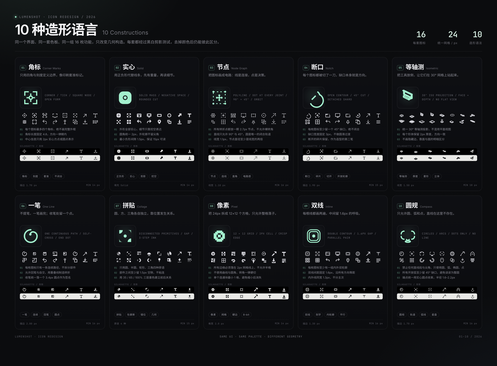

# Lumenshot · 10 种图标造形语言（v2）

这一版只做一件事：**重新设计图标的几何构造**，不是换颜色、换描边、换材质。

- 十套方案共用同一个界面、同一套色板（薄荷 `#A3F0CE`）、同一个 24px 网格。
- 每套 16 枚图标全部手绘，拥有独立的造形语法：角标、实心、节点、断口、等轴测、一笔、拼贴、像素、双线、圆规。
- 每张方案图都带一条 **黑白剪影测试**：同一组图标分别以白底黑形、黑底白形出现，用来证明去掉颜色后仍然能彼此区分。
- 每套的最小可读尺寸、描边、构造规则都写在图里，便于直接评估落地成本。



## 十套方向

| # | 名称 | 一句话 | 最适合 | 最小尺寸 |
|---|------|--------|--------|----------|
| 01 | 角标 Corner Marks | 只用四角与刻度定义边界，像印刷套准标记 | 低风险替换、延续截图/测量语义 | 14 px |
| 02 | 实心 Solid | 用正负形代替线条，远看是一块清楚的剪影 | 15px 小尺寸、需要最强稳定性 | 14 px |
| 03 | 节点 Node Graph | 把图标画成电路，线是连接，点是决策 | 强调精确、可测量、工程感 | 16 px |
| 04 | 断口 Notch | 每个图标都被切了一刀，缺口就是方向 | 品牌记忆点、截图/裁切隐喻 | 15 px |
| 05 | 等轴测 Isometric | 把工具放倒，在 30° 网格上站起来 | 展示型视觉、大尺寸工具栏 | 18 px |
| 06 | 一笔 One Line | 不提笔，一笔画完，收笔留一个点 | 轻松、手作、有签名感 | 16 px |
| 07 | 拼贴 Collage | 圆、方、三角各自独立，靠位置发生关系 | 包豪斯气质、创意工具 | 15 px |
| 08 | 像素 Pixel | 24px 拆成 12×12 格，只允许整格落子 | 强识别、年轻、8-bit 记忆点 | 14 px |
| 09 | 双线 Inline | 每根线画两遍，中间留 1.6px 呼吸 | 高级感、刻字/内轮廓质感 | 16 px |
| 10 | 圆规 Compass | 只允许圆、弧和点，直线不存在 | 星盘/轨道感、最柔和的品牌表达 | 16 px |

## 单张方案

- [00 总览](png/00-overview.png)
- [01 角标 Corner Marks](png/01-corner-marks.png)
- [02 实心 Solid](png/02-solid.png)
- [03 节点 Node Graph](png/03-node-graph.png)
- [04 断口 Notch](png/04-notch.png)
- [05 等轴测 Isometric](png/05-isometric.png)
- [06 一笔 One Line](png/06-one-line.png)
- [07 拼贴 Collage](png/07-collage.png)
- [08 像素 Pixel](png/08-pixel.png)
- [09 双线 Inline](png/09-inline.png)
- [10 圆规 Compass](png/10-compass.png)

## 已落地：03 节点

应用内的 18 个图标资源已替换为 03 节点图标（96×96 透明 PNG，沿用原有资源名，CMake 无需改动）。圆形工具使用四向节点圆轨道，其余图标仍遵守 90° / 45° 连线规则。

- 实机 15–17px 截图：[03-node-app.png](png/03-node-app.png)
- 2x 设备像素染色检查：[03-node-tint-2x.png](png/03-node-tint-2x.png)
- 导出源文件：[export-node.mjs](export-node.mjs)

## 推荐顺序

本次已按选择落地 **03 节点**；下面保留最初的横向评估，供以后换装或做品牌延展时参考。

**首选：09 双线。** 它是十套里“既明显是重新设计、又不会牺牲可读性”的平衡点。双轮廓在 15–17px 会并成一条更厚的线，不会糊；在 34px 又能看出内轮廓的细节。落地也最简单：全部单色 + 透明通道，导出 PNG 后直接替换现有资源即可，Qt 的 `SourceIn` 染色逻辑不用改。

**次选：04 断口。** 如果希望图标本身讲“截图/裁切”的故事，04 的 45° 缺口和脱离碎片是最有品牌记忆点的方案。它的形状差异最大，黑白剪影一眼能认出来。

**最稳：02 实心。** 如果 15px 工具栏的可读性是第一优先级，02 的实心剪影最抗缩小。它的代价是“个性”弱一些，更像一套高质量的系统图标。

**不建议作为默认：05 等轴测、10 圆规。** 05 在 34px 很有雕塑感，但 15px 会损失细节，图内已标注最小 18px；10 的“文字/箭头”为了守住纯圆弧语法，语义会稍微绕一点。它们更适合做展示、启动页或大尺寸工具面板。

## 落地到 Qt 的注意点

- 现有代码通过 `QIcon(":/" + name + ".png")` 加载图标，再用 `QPainter` 的 `CompositionMode_SourceIn` 染色。十套方案都是**单色 + alpha**，所以不需要改绘制逻辑。
- 建议导出 48px 或 72px 的透明 PNG（对应 2x/3x），不要直接导出 24px；Qt 在高 DPI 下缩放会更干净。
- 如果选 07 拼贴或 05 等轴测，图内有 `opacity` / `fill-opacity` 的层次。`SourceIn` 染色会保留 alpha，因此层次会变成同一种薄荷色的深浅变化，不会变成多色。
- 真正需要改代码的只有两种情况：想保留多色/渐变（需要 QtSvg 或自绘），或者想在按钮上做 hover 动效（需要 QPainterPath 动画）。这十套都不属于这两种。

## 文件说明

```
mockups/redesign-v2/
├── build.mjs          # 生成 10 张方案页 + 00 总览
├── shot.mjs           # Playwright 渲染 1600×1180（1.5x → 2400×1770）
├── concepts-a.mjs     # 01–03
├── concepts-b.mjs     # 04–07
├── concepts-c.mjs     # 08–10
├── html/              # 可编辑源文件
├── png/               # 交付图片
└── fonts/             # Inter / JetBrains Mono
```

重新生成：

```bash
node build.mjs
node shot.mjs
```

只渲染某一张：

```bash
node shot.mjs 04
```
