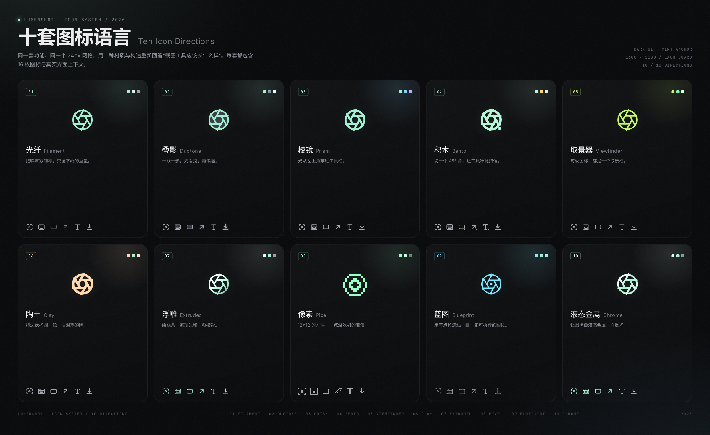

# Lumenshot · 10 套图标语言

以 21st.dev 的暗色组件审美为参照，基于同一套 16 枚图标、同一个 24px 网格，
做出 10 种不同的材质与构造。每张方案图都包含：真实界面上下文、完整图标组、
三态演示、设计参数、放大细节。

## 总览



## 十套方向

| # | 名称 | 一句话 | 最适合 |
|---|------|--------|--------|
| 01 | 光纤 Filament | 1.5px 等重线，去掉一切噪声 | 稳健落地、延续现有 UI |
| 02 | 叠影 Duotone | 薄荷线 + 灰蓝色块，柔和有层次 | 想要更“有情绪”的工具感 |
| 03 | 棱镜 Prism | 磨砂玻璃片 + 渐变边框 + 顶部高光 | 最接近 21st.dev 的高级感 |
| 04 | 积木 Bento | 方头线 + 45° 切角 + 实心激活 | 建立强品牌识别 |
| 05 | 取景器 Viewfinder | 四角括号 + 刻度 + 点阵 | 最贴合“截图/测量”语义 |
| 06 | 陶土 Clay | 2.4px 圆线 + 暖杏点缀 | 更亲和、更轻松的产品气质 |
| 07 | 浮雕 Extruded | 渐变线 + 顶光 + 投影 | 硬件感、专业工具感 |
| 08 | 像素 Pixel | 12×12 方块 + 扫描线 | 年轻、有记忆点 |
| 09 | 蓝图 Blueprint | 节点 + 连线 + 图纸点阵 | 强调精确与工程感 |
| 10 | 液态金属 Chrome | 金属渐变 + 镜面高光 | 奢华、展示型视觉 |

## 单张方案

- [01 光纤 Filament](png/01-filament.png)
- [02 叠影 Duotone](png/02-duotone.png)
- [03 棱镜 Prism](png/03-prism.png)
- [04 积木 Bento](png/04-bento.png)
- [05 取景器 Viewfinder](png/05-viewfinder.png)
- [06 陶土 Clay](png/06-clay.png)
- [07 浮雕 Extruded](png/07-extruded.png)
- [08 像素 Pixel](png/08-pixel.png)
- [09 蓝图 Blueprint](png/09-blueprint.png)
- [10 液态金属 Chrome](png/10-chrome.png)

## 选型建议

- **想要低风险、马上能换：01 光纤。** 它只改线宽、圆角与对齐，替换现有 PNG 即可，
  不需要改 Qt 的布局和绘制逻辑。
- **想要最强的 21st.dev 质感：03 棱镜。** 玻璃片、渐变边框和顶部高光最出效果，
  但 Qt Widgets 需要自绘按钮或改用 QtSvg / QML，工作量最大。
- **想要品牌记忆点：04 积木。** 切角和实心激活态在工具栏里一眼可辨，
  自绘成本中等（QPainterPath 切角 + QSS 颜色）。
- **最贴合截图工具：05 取景器。** 它的括号、刻度和点阵天然属于“取景/测量”，
  建议至少把 05 的“括号 + 坐标”细节融进最终方案。

我的推荐：**以 01 为底，吸收 05 的取景框细节**。既有现在的克制，又有截图工具自己的性格。

## 文件说明

```
mockups/redesign/
├── build.mjs        # 生成 10 个方案 HTML + 总览
├── shot.mjs         # 用 Playwright 渲染 1600×1180 方案图
├── html/            # 可编辑的源文件
├── png/             # 交付图片（2400×1770，1.5x）
└── fonts/           # Inter / JetBrains Mono
```

重新生成：

```bash
node build.mjs
node shot.mjs
```
